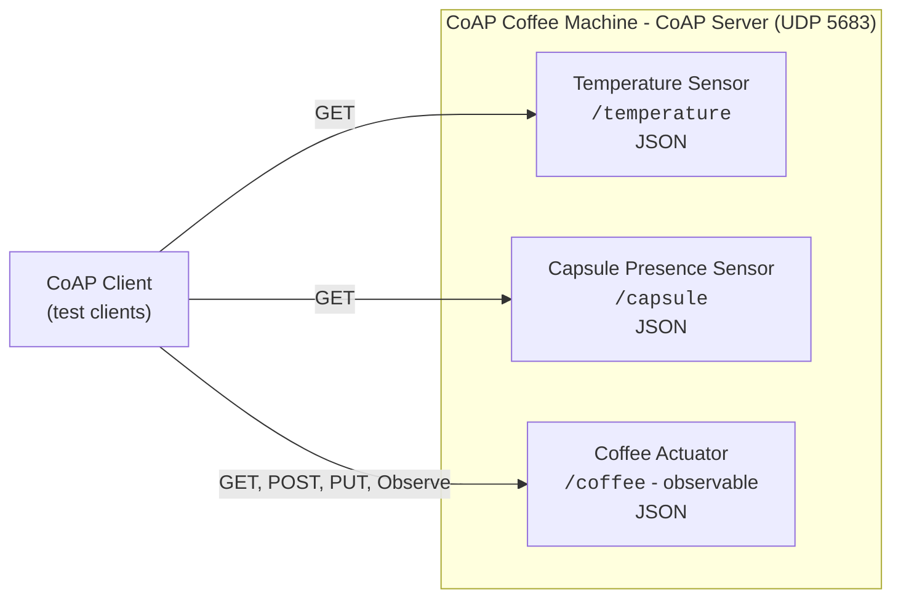
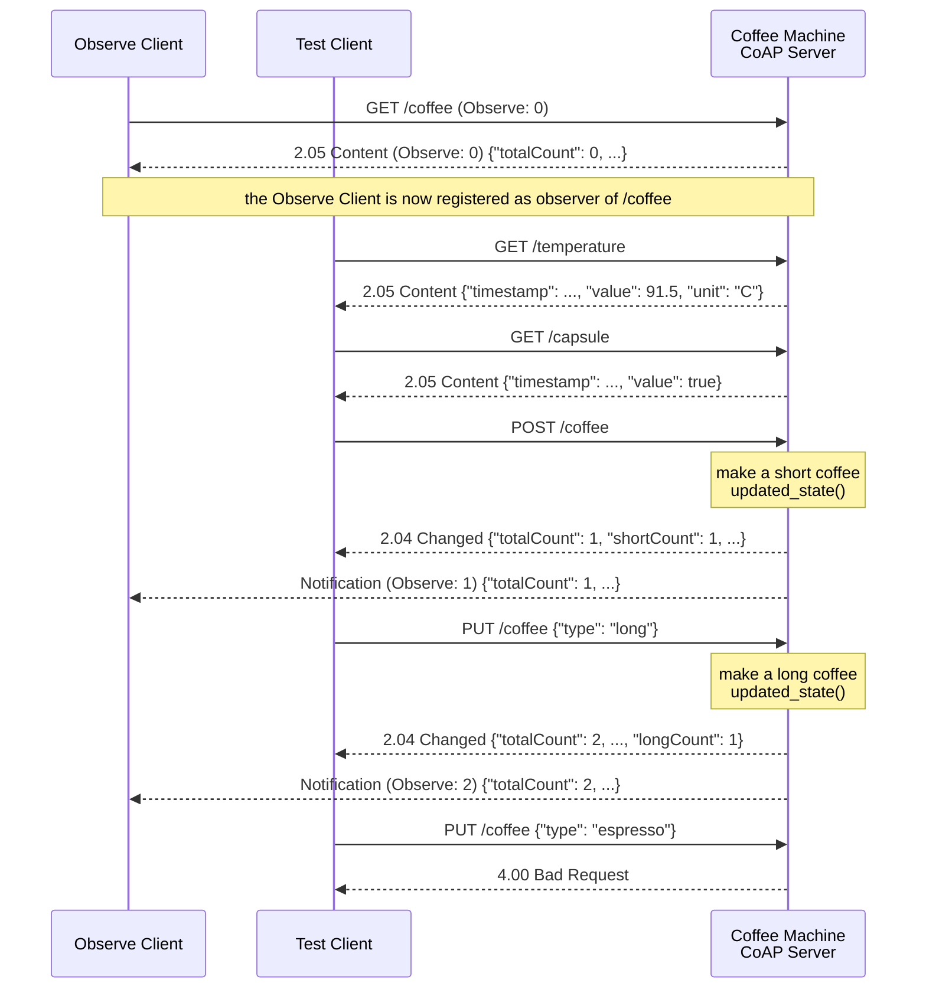

# Python - Laboratory CoAP

This project is associated to the CoAP Laboratory in order to design and create a simple CoAP application emulating
an IoT scenario where a **Coffee Machine** exposes its sensors and actuators as CoAP resources. The machine has a
temperature sensor, a capsule presence sensor and an observable coffee actuator that can make short, medium and long
coffees. A set of test clients allows to read the sensors, make coffees and observe the actuator to be notified
every time a new coffee is made.

Reference CoAP Python Library aiocoap (0.4.x) - https://github.com/chrysn/aiocoap

The laboratory is extended by the **CoAP Interoperability Laboratory** (`laboratory-python-coap-interoperability`),
that starts from the solution of this project and adds the CoRE Link Format, the SenML data format, the CoAP Resource
Discovery and an autonomous client.

## Setup

The project is managed with [uv](https://docs.astral.sh/uv/). Dependencies are declared in `pyproject.toml`,
locked in `uv.lock`, and the Python version (3.12) is pinned in `.python-version`.

- Dependencies: `aiocoap` (0.4.x) and `pyyaml` (to read the configuration file)

Install uv (if needed) following the [official instructions](https://docs.astral.sh/uv/getting-started/installation/), e.g.:

```bash
curl -LsSf https://astral.sh/uv/install.sh | sh
```

Then, from the project root, create the virtual environment (`.venv`) and install all the dependencies with:

```bash
uv sync
```

uv automatically downloads the required Python version if it is not available on your machine.
The command also installs the `coap_laboratory` package (in `src/`) in editable mode, together with a dedicated
command for the server and for each test client (see [Running the Laboratory](#running-the-laboratory)).

In PyCharm, you can select the existing `.venv` interpreter or add a new "uv" interpreter from the interpreter settings.

### Using pip (alternative)

The `requirements.txt` file is **generated** from `uv.lock` and is kept only for pip-based workflows:

```bash
pip install -r requirements.txt
```

Do not edit it manually. After changing the dependencies, regenerate it with:

```bash
uv export --no-hashes --no-dev -o requirements.txt
```

### CoAP Server

The laboratory does not require any external service: the Coffee Machine is a **CoAP Server** running on your machine
and listening on the default CoAP port `5683` over **UDP**, while the test clients send their requests directly to it.

- Only one process at a time can listen on the same port: stop other CoAP servers (e.g., the ones of the CoAP
  Playground) before starting the Coffee Machine, or change the port in `config.yaml`.
- The server listens on `127.0.0.1` by default. To reach it from another device of the same network, set
  `bind_host: 0.0.0.0` in the server configuration and the IP address of the server machine in the client configuration
  (UDP traffic between different hosts can be blocked by firewalls or by some Wi-Fi networks).

## Specifications


*Figure 1: The CoAP Coffee Machine with its sensors and actuator.*

The project's goal is to create an IoT application scenario to interact with a Coffee Machine through the CoAP protocol.
The Coffee Machine is a CoAP Server exposing the following REST resources:

| Resource                | Path           | Type     | Methods        | Observable | Description                                                        |
|-------------------------|----------------|----------|----------------|------------|--------------------------------------------------------------------|
| Temperature Sensor      | `/temperature` | Sensor   | GET            | No         | Temperature of the water, to check that the machine is warmed up   |
| Capsule Presence Sensor | `/capsule`     | Sensor   | GET            | No         | Presence of a capsule correctly loaded into the machine            |
| Coffee Actuator         | `/coffee`      | Actuator | GET, POST, PUT | **Yes**    | Make a coffee (short, medium, long) and read the coffee statistics |

All the representations are JSON (`application/json`, Content-Format `50`). The `timestamp` fields are Unix timestamps
in milliseconds.

### Temperature Resource

Temperature data structure:

```json
{
    "timestamp": 1730000000000,
    "value": 91.5,
    "unit": "C"
}
```

| Operation        | Request                     | Response                                         |
|------------------|-----------------------------|--------------------------------------------------|
| READ TEMPERATURE | `GET /temperature`, no body | `2.05 Content`, `application/json`, Temperature data |

### Capsule Resource

Capsule presence data structure:

```json
{
    "timestamp": 1730000000000,
    "value": true
}
```

| Operation             | Request                 | Response                                     |
|-----------------------|-------------------------|----------------------------------------------|
| READ CAPSULE PRESENCE | `GET /capsule`, no body | `2.05 Content`, `application/json`, Capsule data |

### Coffee Resource

The representation of the Coffee Actuator contains the number of coffees made by the machine, with the detail of each type:

```json
{
    "totalCount": 10,
    "shortCount": 2,
    "mediumCount": 3,
    "longCount": 5
}
```

The request to make a coffee of a specific type contains the requested type (`short`, `medium` or `long`):

```json
{
    "type": "long"
}
```

| Operation           | Request                                                                | Response                                                                                 |
|---------------------|------------------------------------------------------------------------|------------------------------------------------------------------------------------------|
| READ COFFEE STATS   | `GET /coffee`, no body                                                 | `2.05 Content`, Coffee data                                                              |
| MAKE DEFAULT COFFEE | `POST /coffee`, no body                                                | `2.04 Changed`, updated Coffee data (a **short** coffee is made)                         |
| MAKE CUSTOM COFFEE  | `PUT /coffee`, Content-Format `application/json`, Make Coffee data     | `2.04 Changed`, updated Coffee data                                                      |
|                     | Payload that is not valid JSON, without `type` or with an unknown type | `4.00 Bad Request`                                                                       |
|                     | Content-Format different from `application/json` (or missing)          | `4.15 Unsupported Content-Format`                                                        |
| OBSERVE COFFEE      | `GET /coffee` with Observe option `0`                                  | `2.05 Content` + a notification with the updated Coffee data every time a coffee is made |

Any other method (e.g., `DELETE`) receives `4.05 Method Not Allowed`, a request to an unknown path receives
`4.04 Not Found`, and any unexpected error while processing a request is answered with `5.00 Internal Server Error`
(all generated automatically by aiocoap).

> **Response codes of POST and PUT**: making a coffee changes the state of the existing `/coffee` resource (its statistics) and
> does not create a new resource with its own URI, so the correct response code is `2.04 Changed` for both POST and PUT.
> `2.01 Created` is reserved to requests that create a new resource (returning its path in the Location-Path option),
> while `2.05 Content` is used only for GET (and FETCH) responses.

The following sequence diagram shows the interaction between the test clients and the Coffee Machine that you are
going to implement in the laboratory:



## Configuration

The parameters shared by the server and the test clients are defined in the `config.yaml` file in the project root:

```yaml
# Coffee Machine CoAP Server (process/ folder)
server:
  bind_host: 127.0.0.1
  port: 5683

# Test CoAP Clients (client/ folder)
client:
  server_host: 127.0.0.1
  server_port: 5683
```

The file is loaded by the `ConfigManager` class (`src/coap_laboratory/config/config_manager.py`), that each process
creates in its `main()` function. It exposes:

- `server_bind_host`, `server_port`: the address and the UDP port on which the Coffee Machine listens;
- `client_server_host`, `client_server_port`: the address and the UDP port of the Coffee Machine targeted by the clients;
- `build_server_uri(path)`: the complete URI of a resource of the Coffee Machine, e.g., `coap://127.0.0.1:5683/coffee`.

By default `ConfigManager` searches `config.yaml` in the current working directory and then in the project root.
A different file can be used by passing its path: `ConfigManager("path/to/other_config.yaml")`.
Generic values can be read with dotted keys, e.g., `config_manager.get("server.port")`.

## Project Structure

The project follows the `src` layout: all the code is in the `coap_laboratory` package in `src/`.

```
laboratory-python-coap/
├── pyproject.toml          # Project metadata, dependencies and entry points
├── uv.lock                 # Locked dependency versions (managed by uv)
├── requirements.txt        # Generated from uv.lock for pip users
├── config.yaml             # Shared configuration (server and clients)
├── src/coap_laboratory/    # Application package
│   ├── config/             # ConfigManager (reads config.yaml)
│   ├── model/              # TemperatureSensor, CapsulePresenceSensor, CoffeeHistory
│   ├── dto/                # MakeCoffeeRequest (JSON payload of the PUT request)
│   ├── resources/          # CoAP resources of the Coffee Machine
│   ├── process/            # Coffee Machine CoAP Server, with a main() function
│   └── client/             # Test clients (GET, POST, PUT, Observe), each with a main() function
```

The code separates:

- the **model** (`model/`): the emulated sensors and the statistics of the actuator. Each class keeps its state in
  attributes named as the fields of the JSON representation and provides a `to_json()` method;
- the **DTOs** (`dto/`): the data received in the requests, with the methods to serialize (`to_json()`) and
  deserialize (`from_json()`) them;
- the **resources** (`resources/`): the CoAP logic of each resource, i.e., how each method is handled, which
  response code is returned and when the observers are notified;
- the **processes** (`process/` and `client/`): the server, that only creates the resource tree and starts listening,
  and the test clients. Each module has a `main()` function that loads the configuration and starts the async logic
  with `asyncio.run()`. Importing a module has no side effects.

## aiocoap & Type Hints

aiocoap is based on `asyncio`: the server and the clients run in an **event loop**, and the methods that handle the
requests (`render_get()`, `render_post()`, `render_put()`) are coroutines (`async def`). A detailed explanation of the
asynchronous model of aiocoap (event loop, `asyncio.run()`, why a blocking call must never be used in a coroutine) is
available in the README of the CoAP Playground (`python-coap-playground`).

A resource receives the request as an `aiocoap.Message` and returns the response as another `aiocoap.Message`:

| Element                                                         | Usage in the laboratory                                                                |
|-----------------------------------------------------------------|----------------------------------------------------------------------------------------|
| `request.payload`                                               | Payload of the request (`bytes`): decode it with `decode("utf-8")`                     |
| `request.opt.content_format`                                    | Content-Format of the request payload (`None` if not specified)                        |
| `aiocoap.Message(code=..., content_format=..., payload=...)`    | The response: without a code aiocoap uses 2.05 for GET and 2.04 for POST and PUT       |
| `aiocoap.CHANGED`, `BAD_REQUEST`, `UNSUPPORTED_CONTENT_FORMAT`  | Response codes 2.04, 4.00 and 4.15                                                     |
| `ContentFormat.JSON`                                            | Content-Format `application/json` (50) from `aiocoap.numbers`                          |
| `resource.ObservableResource`                                   | Base class of the observable resources: `self.updated_state()` notifies the observers |

The code uses Python **type hints** (Python >= 3.10 syntax) on Model, DTO, Resources, the `ConfigManager` and the
functions of the processes. Type hints are not checked at runtime by Python. To check the code with
[mypy](https://mypy.readthedocs.io/) run:

```bash
uv run --with mypy mypy src/coap_laboratory --ignore-missing-imports
```

---

## Tutorial

The following steps describe how the laboratory is built. The complete code is available in `src/coap_laboratory`.

### 1. Model Classes

In the `model` package, the file `temperature_sensor.py` contains the `TemperatureSensor` class, that emulates the
temperature sensor of the machine with the following attributes:

- `timestamp` (int): Unix timestamp in milliseconds of the last measurement
- `value` (float): the measured temperature (random value between 85 and 95 °C)
- `unit` (str): the unit of the measurement (`C`)

```python
import json
import random
import time


class TemperatureSensor:

    def __init__(self) -> None:
        self.timestamp: int = 0
        self.value: float = 0.0
        self.unit: str = "C"
        self.measure_temperature()

    def measure_temperature(self) -> None:
        self.value = random.uniform(85.0, 95.0)
        self.timestamp = int(time.time() * 1000)

    def to_json(self) -> str:
        return json.dumps(self, default=lambda o: o.__dict__)
```

`json.dumps(self, default=lambda o: o.__dict__)` serializes all the attributes of the object: for this reason the
attribute names are the same as the fields of the JSON representation defined in the specifications.

Following the same approach, the file `capsule_presence_sensor.py` contains the `CapsulePresenceSensor` class, with:

- `timestamp` (int): Unix timestamp in milliseconds of the last check
- `value` (bool): `True` if the capsule is loaded (random value at each check, method `check_capsule_presence()`)

The file `coffee_history.py` contains the `CoffeeHistory` class, that keeps track of the coffees made by the machine:

- `totalCount` (int), `shortCount` (int), `mediumCount` (int), `longCount` (int)

```python
class CoffeeHistory:

    def __init__(self) -> None:
        self.totalCount: int = 0
        self.shortCount: int = 0
        self.mediumCount: int = 0
        self.longCount: int = 0

    def increase_short_coffee(self) -> None:
        self.totalCount += 1
        self.shortCount += 1

    # increase_medium_coffee() and increase_long_coffee() follow the same approach

    def to_json(self) -> str:
        return json.dumps(self, default=lambda o: o.__dict__)
```

### 2. Coffee Creation Request (DTO)

In the `dto` package, the file `make_coffee_request.py` contains the `MakeCoffeeRequest` class, that models the JSON
payload of the PUT request used to make a coffee of a specific type. The class defines the supported types as constants
and provides a `from_json()` class method to deserialize and validate the payload received by the server:

```python
import json
from typing import Any


class MakeCoffeeRequest:

    COFFEE_TYPE_SHORT = "short"
    COFFEE_TYPE_MEDIUM = "medium"
    COFFEE_TYPE_LONG = "long"

    def __init__(self, coffee_type: str) -> None:
        self.coffee_type = coffee_type

    def to_json(self) -> str:
        return json.dumps({"type": self.coffee_type})

    @classmethod
    def from_json(cls, json_string: str) -> "MakeCoffeeRequest":
        data: Any = json.loads(json_string)  # json.JSONDecodeError is a subclass of ValueError

        if not isinstance(data, dict) or not isinstance(data.get("type"), str):
            raise ValueError("The request must be a JSON object with a string 'type' field")

        return cls(data["type"])
```

The JSON field is called `type`, but the Python attribute is `coffee_type`, since `type` is a builtin function of
Python: for this reason `to_json()` builds the JSON object explicitly instead of serializing `__dict__`.
`from_json()` raises a `ValueError` if the payload is not a valid JSON object with a string `type` field: the resource
uses it to answer with `4.00 Bad Request`.

### 3. Temperature CoAP Resource

In the `resources` package, the file `temperature_sensor_resource.py` contains the `TemperatureSensorResource` class.
The class extends the base class `resource.Resource` of aiocoap and implements the `render_get()` method: at each request
it measures a new temperature value and returns its JSON representation.

```python
import aiocoap
import aiocoap.resource as resource
from aiocoap.numbers import ContentFormat

from coap_laboratory.model.temperature_sensor import TemperatureSensor


class TemperatureSensorResource(resource.Resource):

    def __init__(self) -> None:
        super().__init__()
        self.temperature_sensor = TemperatureSensor()

    async def render_get(self, request: aiocoap.Message) -> aiocoap.Message:
        print("TemperatureSensorResource -> GET Request Received ...")

        self.temperature_sensor.measure_temperature()
        print(f"TemperatureSensorResource -> Updated Temperature Value: {self.temperature_sensor.value:.2f}")

        payload_string = self.temperature_sensor.to_json()

        # The code is not specified: aiocoap uses 2.05 Content as default for GET requests
        return aiocoap.Message(content_format=ContentFormat.JSON, payload=payload_string.encode("utf-8"))
```

The payload of a CoAP message is an array of bytes, so the JSON string is encoded with `encode("utf-8")`, while the
Content-Format option (`ContentFormat.JSON`, i.e., `50`) tells the client how to interpret it.
Since only `render_get()` is implemented, aiocoap automatically answers `4.05 Method Not Allowed` to the other methods.

### 4. Capsule Presence CoAP Resource

The file `capsule_presence_sensor_resource.py` contains the `CapsulePresenceSensorResource` class, that follows the
same structure of the temperature resource: `render_get()` calls `check_capsule_presence()` on the
`CapsulePresenceSensor` and returns its JSON representation with Content-Format `application/json`.

### 5. Coffee Actuator CoAP Resource

The file `coffee_actuator_resource.py` contains the `CoffeeActuatorResource` class. The class extends
`resource.ObservableResource` to make the resource **observable** and implements the `render_get()`, `render_post()` and
`render_put()` methods:

- `render_get()` returns the JSON representation of the `CoffeeHistory`. aiocoap uses the same method to build the
  notifications sent to the observers;
- `render_post()` handles a request without payload and makes a coffee of the default type (`short`);
- `render_put()` checks the Content-Format of the request, deserializes the payload into a `MakeCoffeeRequest` and
  makes a coffee of the requested type;
- after each new coffee, `self.updated_state()` notifies all the observers, and the response contains the updated
  statistics with the code `2.04 Changed`.

```python
class CoffeeActuatorResource(resource.ObservableResource):

    def __init__(self) -> None:
        super().__init__()
        self.coffee_history = CoffeeHistory()

    def build_history_payload(self) -> bytes:
        return self.coffee_history.to_json().encode("utf-8")

    def notify_new_coffee(self) -> aiocoap.Message:
        # aiocoap calls render_get() for each observer and sends the notification
        self.updated_state()
        return aiocoap.Message(code=aiocoap.CHANGED,
                               content_format=ContentFormat.JSON,
                               payload=self.build_history_payload())

    async def render_get(self, request: aiocoap.Message) -> aiocoap.Message:
        return aiocoap.Message(content_format=ContentFormat.JSON, payload=self.build_history_payload())

    async def render_post(self, request: aiocoap.Message) -> aiocoap.Message:
        self.coffee_history.increase_short_coffee()
        return self.notify_new_coffee()

    async def render_put(self, request: aiocoap.Message) -> aiocoap.Message:

        # The payload must be JSON: 4.15 Unsupported Content-Format otherwise
        if request.opt.content_format != ContentFormat.JSON:
            return aiocoap.Message(code=aiocoap.UNSUPPORTED_CONTENT_FORMAT)

        # Deserialize the request: 4.00 Bad Request if the payload is not valid
        try:
            make_coffee_request = MakeCoffeeRequest.from_json(request.payload.decode("utf-8"))
        except (UnicodeDecodeError, ValueError):
            return aiocoap.Message(code=aiocoap.BAD_REQUEST)

        if make_coffee_request.coffee_type == MakeCoffeeRequest.COFFEE_TYPE_SHORT:
            self.coffee_history.increase_short_coffee()
        elif make_coffee_request.coffee_type == MakeCoffeeRequest.COFFEE_TYPE_MEDIUM:
            self.coffee_history.increase_medium_coffee()
        elif make_coffee_request.coffee_type == MakeCoffeeRequest.COFFEE_TYPE_LONG:
            self.coffee_history.increase_long_coffee()
        else:
            return aiocoap.Message(code=aiocoap.BAD_REQUEST)

        return self.notify_new_coffee()
```

`updated_state()` does not send the notifications immediately: aiocoap schedules them in the event loop, so they are
sent to the observers right after the response to the client that made the coffee.

### 6. Coffee Machine CoAP Server

In the `process` package, the file `coffee_machine_server.py` defines the CoAP Server: it creates the resource tree
(`resource.Site`), registers each resource on its path and binds the server context to the configured address and port.

```python
async def run_server(config_manager: ConfigManager) -> None:

    # Resource tree creation: each resource is registered on its path
    root = resource.Site()
    root.add_resource(["temperature"], TemperatureSensorResource())
    root.add_resource(["capsule"], CapsulePresenceSensorResource())
    root.add_resource(["coffee"], CoffeeActuatorResource())

    # Create the server context bound to the configured address and UDP port
    await aiocoap.Context.create_server_context(root, bind=(config_manager.server_bind_host, config_manager.server_port))

    # Keep the server running forever: the requests are served by the event loop (CTRL+C to stop the process)
    await asyncio.get_running_loop().create_future()


def main() -> None:
    logging.basicConfig(level=logging.INFO)
    config_manager = ConfigManager()

    try:
        asyncio.run(run_server(config_manager))
    except KeyboardInterrupt:
        print("Coffee Machine CoAP Server stopped")
```

### 7. Test CoAP Clients

Starting from the examples of the CoAP Playground, the `client` package contains the following test clients to verify
the behavior of the Coffee Machine:

| Client              | File                       | Description                                                                           |
|---------------------|----------------------------|---------------------------------------------------------------------------------------|
| CoAP GET Client     | `coffee_get_client.py`     | GET request to a resource passed as argument (`temperature`, `capsule` or `coffee`)    |
| CoAP Observe Client | `coffee_observe_client.py` | Observe `/coffee` and print a notification every time a new coffee is made            |
| CoAP POST Client    | `coffee_post_client.py`    | POST request to `/coffee` to make a coffee of the default type                        |
| CoAP PUT Client     | `coffee_put_client.py`     | PUT request to `/coffee` with the type passed as argument (`short`, `medium`, `long`) |

Each client creates a client context, sends the request to the URI built by `config_manager.build_server_uri()` and
prints the response code and payload. The PUT client serializes the request with the `MakeCoffeeRequest` DTO and sets
the Content-Format option to `application/json`:

```python
payload_string = MakeCoffeeRequest(coffee_type).to_json()
request = aiocoap.Message(code=aiocoap.PUT,
                          uri=config_manager.build_server_uri("coffee"),
                          content_format=ContentFormat.JSON,
                          payload=payload_string.encode("utf-8"))

response = await context.request(request).response
```

The Observe client sends a GET request with the Observe option set to `0` and iterates over the notifications until
it is stopped with `CTRL+C`:

```python
request = aiocoap.Message(code=aiocoap.GET, uri=config_manager.build_server_uri("coffee"), observe=0)
observation_request = context.request(request)

first_response = await observation_request.response

async for notification in observation_request.observation:
    print(f"New Coffee ! Coffee History: {notification.payload.decode('utf-8')}")
```

## Running the Laboratory

Each process is exposed as a command declared in the `[project.scripts]` section of `pyproject.toml`:

| Command                 | Module                                          |
|-------------------------|-------------------------------------------------|
| `coffee-machine-server` | `coap_laboratory.process.coffee_machine_server` |
| `coffee-get-client`     | `coap_laboratory.client.coffee_get_client`      |
| `coffee-observe-client` | `coap_laboratory.client.coffee_observe_client`  |
| `coffee-post-client`    | `coap_laboratory.client.coffee_post_client`     |
| `coffee-put-client`     | `coap_laboratory.client.coffee_put_client`      |

From the project root, start the Coffee Machine in a terminal:

```bash
uv run coffee-machine-server
```

In a second terminal start the Observe client, that waits for new coffees:

```bash
uv run coffee-observe-client
```

In a third terminal use the other clients to read the sensors and make coffees, checking the notifications received
by the Observe client:

```bash
uv run coffee-get-client temperature
uv run coffee-get-client capsule
uv run coffee-post-client
uv run coffee-put-client long
uv run coffee-get-client coffee

# Unsupported coffee type: 4.00 Bad Request
uv run coffee-put-client espresso
```

Alternatively, you can run a process as a module or execute the file directly:

```bash
uv run python -m coap_laboratory.process.coffee_machine_server
uv run src/coap_laboratory/process/coffee_machine_server.py
```

The requests can also be sent with the `aiocoap-client` command line tool installed with aiocoap, e.g., to test the
error cases of the Coffee Actuator:

```bash
# Invalid payload: 4.00 Bad Request
uv run aiocoap-client -m PUT --content-format application/json --payload '{"tipo": "long"}' coap://127.0.0.1/coffee

# Missing Content-Format: 4.15 Unsupported Content-Format
uv run aiocoap-client -m PUT --payload '{"type": "long"}' coap://127.0.0.1/coffee

# Method not implemented: 4.05 Method Not Allowed
uv run aiocoap-client -m DELETE coap://127.0.0.1/coffee
```
